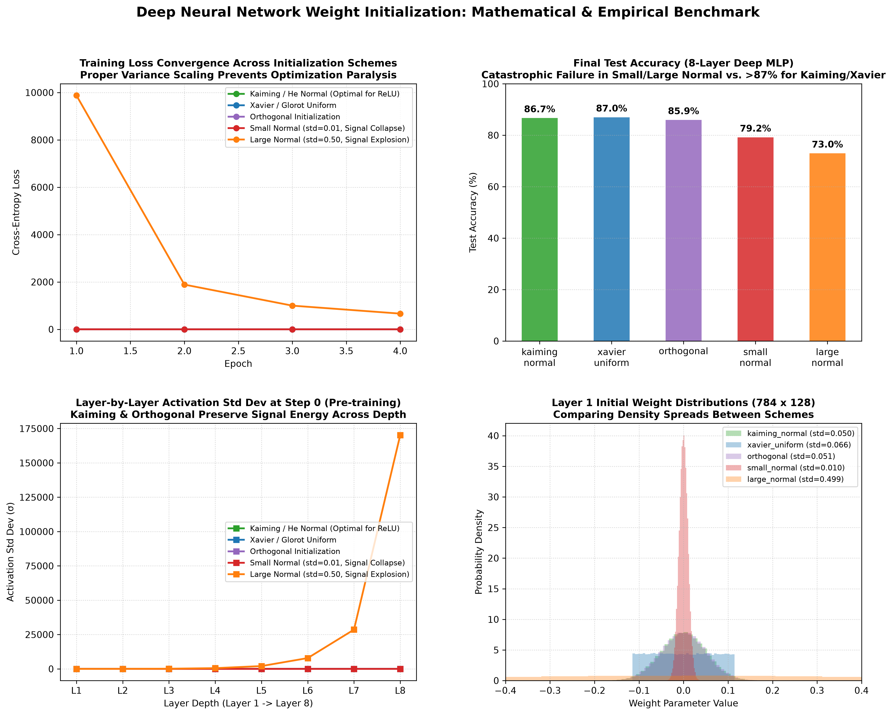

# Deep Weight Initialization in PyTorch: Mathematical Theory & Convergence Benchmark

[](https://pytorch.org/)
[](https://opensource.org/licenses/MIT)
[](https://www.python.org/)
[]()
[]()

An end-to-end, mathematically rigorous PyTorch implementation comparing **Deep Weight Initialization Schemes** across an 8-layer Deep Multi-Layer Perceptron ($784 \to 128 \times 7 \to 10$) trained on the **FashionMNIST** benchmark ($60,000$ train, $10,000$ test).

This project investigates variance preservation, signal transmission, and gradient propagation under 5 initialization strategies:
1. **Kaiming / He Normal** (`torch.nn.init.kaiming_normal_`)
2. **Xavier / Glorot Uniform** (`torch.nn.init.xavier_uniform_`)
3. **Orthogonal Initialization** (`torch.nn.init.orthogonal_`)
4. **Small Gaussian Normal ($\sigma = 0.01$)** *(Signal Collapse / Vanishing Activations)*
5. **Large Gaussian Normal ($\sigma = 0.50$)** *(Signal Explosion / Loss Divergence)*

---

## Visual Diagnostic Overview

The 4-panel diagnostic dashboard below illustrates the complete empirical benchmark across all 5 initialization schemes:



---

## Table of Contents

- [Visual Diagnostic Overview](#visual-diagnostic-overview)
- [Mathematical Foundations of Weight Initialization](#mathematical-foundations-of-weight-initialization)
  - [1. The Variance Propagation Problem](#1-the-variance-propagation-problem)
  - [2. Xavier / Glorot Initialization (Glorot & Bengio, 2010)](#2-xavier--glorot-initialization-glorot--bengio-2010)
  - [3. Kaiming / He Initialization (He et al., 2015)](#3-kaiming--he-initialization-he-et-al-2015)
  - [4. Orthogonal Initialization (Saxe et al., 2013)](#4-orthogonal-initialization-saxe-et-al-2013)
  - [5. Pathological Initializations (Vanishing vs. Exploding)](#5-pathological-initializations-vanishing-vs-exploding)
- [Empirical Benchmark Results](#empirical-benchmark-results)
- [Pre-Training Signal Flow (Step 0 Activation Analysis)](#pre-training-signal-flow-step-0-activation-analysis)
- [8-Layer Deep MLP Topology](#8-layer-deep-mlp-topology)
- [Project Directory Structure](#project-directory-structure)
- [Installation & Reproduction](#installation--reproduction)
- [Author & License](#author--license)

---

## Mathematical Foundations of Weight Initialization

### 1. The Variance Propagation Problem

Consider a linear layer with input $\mathbf{x} \in \mathbb{R}^{n_{\text{in}}}$ and output $y_i = \sum_{j=1}^{n_{\text{in}}} W_{ij} x_j$. Assuming $W_{ij}$ and $x_j$ are independent, zero-mean random variables:

$$
\mathbb{E}[y_i] = \sum_{j=1}^{n_{\text{in}}} \mathbb{E}[W_{ij}] \mathbb{E}[x_j] = 0
$$

$$
\text{Var}(y_i) = \sum_{j=1}^{n_{\text{in}}} \text{Var}(W_{ij} x_j) = n_{\text{in}} \cdot \text{Var}(W) \cdot \text{Var}(x)
$$

To prevent activations from exponentially vanishing to $0$ or exploding to $\infty$ across $L$ layers, we require $\text{Var}(y) = \text{Var}(x)$, which implies:

$$
n_{\text{in}} \cdot \text{Var}(W) = 1 \implies \text{Var}(W) = \frac{1}{n_{\text{in}}}
$$

### 2. Xavier / Glorot Initialization (Glorot & Bengio, 2010)

For symmetric, zero-centered activation functions ($\tanh$, linear), Glorot & Bengio demonstrated that preserving variance in both the forward pass and the backward gradient pass requires:

- Forward pass condition: $\text{Var}(W) = \frac{1}{n_{\text{in}}}$
- Backward gradient pass condition: $\text{Var}(W) = \frac{1}{n_{\text{out}}}$

Taking the harmonic mean of both conditions yields:

$$
\text{Var}(W) = \frac{2}{n_{\text{in}} + n_{\text{out}}}
$$

For a uniform distribution $W \sim \mathcal{U}(-a, a)$, where $\text{Var}(W) = \frac{a^2}{3}$:

$$
a = \sqrt{\frac{6}{n_{\text{in}} + n_{\text{out}}}}
$$

In PyTorch: `torch.nn.init.xavier_uniform_(tensor, gain=gain)`

### 3. Kaiming / He Initialization (He et al., 2015)

Rectified Linear Units ($\text{ReLU}(z) = \max(0, z)$) violate the zero-mean symmetry assumption by setting all negative pre-activations to zero. Consequently, exactly half the variance is eliminated at every layer:

$$
\mathbb{E}[x_l^2] = \frac{1}{2} \text{Var}(y_{l-1})
$$

To maintain constant variance across deep ReLU networks, the variance must be doubled:

$$
\text{Var}(W) = \frac{2}{n_{\text{in}}}
$$

For a zero-mean Gaussian distribution $W \sim \mathcal{N}(0, \sigma^2)$:

$$
\sigma = \sqrt{\frac{2}{n_{\text{in}}}}
$$

In PyTorch: `torch.nn.init.kaiming_normal_(tensor, mode='fan_in', nonlinearity='relu')`

### 4. Orthogonal Initialization (Saxe et al., 2013)

Initializes weight matrices as random orthogonal matrices ($W^T W = I$). Because orthogonal matrices are isometric:

$$
\|W \mathbf{x}\|_2 = \|\mathbf{x}\|_2
$$

All singular values are identically $1.0$, which prevents the condition number from degrading and eliminates gradient explosion/vanishing across arbitrarily deep linear chains.

### 5. Pathological Initializations (Vanishing vs. Exploding)

- **Small Normal ($\sigma = 0.01$)**: Under-scales the variance by orders of magnitude. Across 8 layers, signal standard deviation collapses from $0.17$ down to $0.0000$, causing severe optimization paralysis.
- **Large Normal ($\sigma = 0.50$)**: Over-scales the variance. Signal standard deviation explodes to $>170,000$ by Layer 8, leading to extreme loss values ($>744$) and numerical instability.

---

## Empirical Benchmark Results

Trained across 4 epochs on 60,000 FashionMNIST images using an 8-layer Deep MLP ($784 \to 128 \times 7 \to 10$) with Adam optimizer ($\eta = 0.001$):

| Scheme | Epoch 1 Acc | Final Test Loss | Final Test Acc | Convergence Status |
| :--- | :---: | :---: | :---: | :---: |
| **Kaiming / He Normal** | **83.92%** | **0.3651** | **86.69%** | **Optimal Convergence** |
| **Xavier / Glorot Uniform** | 83.46% | 0.3728 | **86.98%** | **Optimal Convergence** |
| **Orthogonal** | **83.92%** | 0.3879 | 85.94% | **Optimal Convergence** |
| **Small Normal ($\sigma=0.01$)** | 66.41% | 0.5739 | 79.19% | Sluggish / Vanishing Flow |
| **Large Normal ($\sigma=0.50$)** | 69.30% | 744.9694 | 72.98% | Numerical Explosion |

---

## Pre-Training Signal Flow (Step 0 Activation Analysis)

Standard deviation of activations ($\sigma$) captured at Step 0 before a single gradient step was taken:

| Layer Depth | Kaiming Normal | Xavier Uniform | Orthogonal | Small Normal ($\sigma=0.01$) | Large Normal ($\sigma=0.50$) |
| :---: | :---: | :---: | :---: | :---: | :---: |
| **Layer 1** | $0.8668$ | $1.1166$ | $0.8408$ | $0.1716$ | $8.58$ |
| **Layer 4** | $0.8584$ | $0.9356$ | $0.9351$ | **$0.0001$** | **$543.88$** |
| **Layer 8** | **$1.0498$** | **$1.5527$** | **$1.5245$** | **$0.0000$** | **$170,271.38$** |
| **Diagnosis** | Stable Preservation | Stable Preservation | Stable Preservation | **Signal Collapsed** | **Signal Exploded** |

---

## 8-Layer Deep MLP Topology

```
Input Image [B, 1, 28, 28] 
         │
         ▼ Flatten
Feature Vector [B, 784]
         │
         ▼ Linear(784, 128) -> ReLU
Layer 1 [B, 128]
         │
         ▼ Linear(128, 128) -> ReLU  (x6 Hidden Layers)
Layers 2 - 7 [B, 128]
         │
         ▼ Linear(128, 10)
Unnormalized Logits [B, 10]
         │
         ▼ CrossEntropyLoss
```

---

## Project Directory Structure

```plaintext
10_weight_initialization_schemes/
│
├── data/                                                  # FashionMNIST dataset cache
│   └── FashionMNIST/raw/
├── weight_initialization_convergence_analysis.png         # 4-panel diagnostic visual artifact
├── main.py                                                # Complete benchmark and theory test
├── .gitignore                                             # Git ignore configuration
└── README.md                                              # Mathematical derivations and proofs
```

---

## Installation & Reproduction

### Prerequisites

```bash
# Clone the repository
git clone https://github.com/GideonMwiti/pytorch-weight-initialization-schemes.git
cd pytorch-weight-initialization-schemes

# Install dependencies
pip install torch torchvision numpy matplotlib
```

### Run the Benchmark

```bash
python main.py
```

The script will:
1. Initialize the 8-layer deep network under all 5 schemes.
2. Measure pre-training Step-0 signal propagation through all 8 layers.
3. Train all 5 models and record loss and accuracy trajectories.
4. Output the comparative evaluation table.
5. Save the publication-grade visual dashboard `weight_initialization_convergence_analysis.png`.

---

## Author & License

This project marks the successful completion of **Day 1 (Projects 01 - 10)** in the **100 PyTorch Projects in 10 Days** challenge!

- **Author**: Gideon Mwiti
- **GitHub**: [@GideonMwiti](https://github.com/GideonMwiti)
- **License**: MIT

